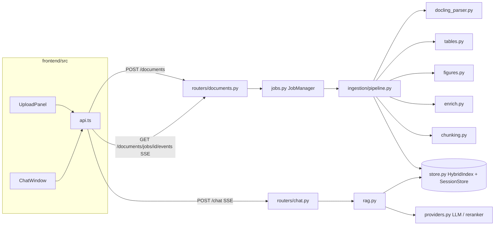

# Architecture

## Overview

The project is two apps. A **FastAPI backend** (`backend/app`) ingests an uploaded policy document into a per-session, in-memory hybrid index and answers questions over it. A **React + Vite frontend** (`frontend/src`) handles upload, shows ingestion progress and the ingestion report, and runs the chat.

There is no database. Sessions live in process memory and expire after a TTL. Every model (chat LLM, vision LLM, embeddings, reranker) is chosen in `backend/.env` and built by factories in `app/providers.py`.

The backend is organised as a pipeline, not as a layered CRUD app:

- `app/ingestion/` turns bytes into a structured, searchable index.
- `app/store.py` holds that index.
- `app/rag.py` answers questions against it.
- `app/routers/` is a thin HTTP layer over all of the above.

## How it fits together

### Upload → index (one document)

1. `UploadPanel` sends the file. `uploadDocument()` in `api.ts` calls `POST /documents`, which is handled in `routers/documents.py`.
2. The router checks the extension (`.pdf`/`.docx`), size (`MAX_UPLOAD_MB`) and PDF magic bytes. It then calls `JobManager.submit()` (`jobs.py`) and returns a `job_id` straight away.
3. A worker thread runs `ingest()` in `ingestion/pipeline.py`, which reports progress through `JobManager._update`.
   1. **Parse**: `get_parser()` (`parser_base.py`) returns `DoclingParser` (`docling_parser.py`).
      - `triage_pdf()` uses PyMuPDF to find pages with no text layer and to collect word coordinates.
      - Docling runs layout, TableFormer and RapidOCR.
      - `recover_clipped_words()` restores text that overflows a cell border.
      - `_to_blocks()` emits a parser-neutral `ParsedDocument` (`models.py`).
   2. **Tables**: `absorb_trailing_footnotes()` then `merge_cross_page_tables()` (`tables.py`).
   3. **Structure**: `chunking.build_structure()` walks the blocks with a heading stack.
      - Prose becomes text parents and units.
      - Each table goes through `normalise_table()` (header flattening, group rows, forward-fill, footnote links) and becomes table parents (row groups) plus one row-sentence unit per row.
      - Definitions feed the glossary.
   4. **Figures**: `skip_reason()` drops logos and icons. `describe_figures()` calls the vision LLM in a batch, falling back to caption + inner text. Then `finish_figures()` creates the figure parents and units.
   5. **Enrichment**: `summarise_tables()` runs the LLM in a batch, falling back to `fallback_summary()`. `add_table_summaries()` adds the summary units. `_retag_general()` is optional LLM tagging.
   6. **Index**: `HybridIndex` (`store.py`) embeds the units in concurrent batches into a normalised NumPy matrix and builds `BM25Okapi` over the same units.
   7. `build_report()` produces the ingestion report. The `Session` is stored in `SessionStore`.
4. The frontend follows progress through `watchJob()`, an EventSource on `GET /documents/jobs/{id}/events`. When the job is done it fetches `GET /documents/{sid}/report`.

### Question → answer

1. `ChatWindow` → `App.onAsk()` → `streamChat()` (`api.ts`) sends `POST /chat` with `{session_id, question, history}` (`schemas.ChatRequest`).
2. `routers/chat.py` streams `answer_stream()` from `rag.py`:
   1. `rewrite_query()` turns a follow-up into a standalone query (it is skipped when there is no history).
   2. `retrieve()` calls `HybridIndex.search()`: dense top-k + BM25 top-k, reciprocal-rank fusion, a category boost from `query_categories()`, then collapse to parents. The `Reranker` then narrows the list to `FINAL_K`.
   3. `build_context()` turns the parents into numbered `<source>` blocks and adds glossary definitions found with `find_terms()`.
   4. The chat LLM streams an answer, using `SYSTEM_PROMPT` and `ANSWER_TEMPLATE` from `prompts.py`.
3. SSE events go out in this order: `query`, then `token`…, then `citations`, then `done` (`error` on failure). `streamChat()` parses them by hand, because EventSource cannot POST.

## Directories

| Path | Purpose |
| --- | --- |
| `backend/app/` | FastAPI app: settings, provider factories, session store, RAG answering, HTTP routers |
| `backend/app/ingestion/` | The ingestion engine: parser interface and Docling backend, table normalisation, figures, enrichment, chunking, orchestration |
| `backend/app/routers/` | HTTP endpoints (documents/jobs/report/figures, chat) |
| `backend/tests/` | pytest suite, plus `fixtures/` with a generator for a synthetic policy PDF |
| `frontend/src/` | React app: API client, app shell, components |
| `docs/` | This architecture document |
| `.claude/launch.json` | Dev-server launch configs (backend on :8000, frontend on :5173) used by Claude Code's preview |

## File reference

### Backend: core

| File | Purpose |
| --- | --- |
| `backend/app/main.py` | FastAPI app. In the lifespan it builds `AppState` if none is injected (tests inject one), warms up the Docling models in a background thread, and runs a janitor task every 60 s that evicts expired sessions and old jobs. Defines CORS, `/` and `/health`. |
| `backend/app/config.py` | `Settings` (pydantic-settings) read from `backend/.env`, with an absolute path so it works from any directory. `get_settings()` also calls `load_dotenv()` so provider SDKs see API keys in `os.environ`. |
| `backend/app/providers.py` | Factories for the pluggable models: `get_llm()`, `get_vision_llm()` (both through `init_chat_model`), `get_embeddings()` (openai/voyage/cohere/fake) and `get_reranker()` (none/cohere). Provider packages are imported lazily. |
| `backend/app/fakes.py` | `EchoChatModel`, the offline `LLM_PROVIDER=fake`. It returns the query for rewrite prompts and the first `<source>` excerpt for answer prompts. |
| `backend/app/deps.py` | `AppState` dataclass (settings, store, jobs, llm, reranker) and the `get_state` dependency. |
| `backend/app/jobs.py` | `JobManager`: a 2-worker thread pool that runs `ingest()`. It keeps a versioned `Job` snapshot for the SSE endpoint to poll and prunes finished jobs after 1 h. |
| `backend/app/observability.py` | Langfuse wrapper: client setup from settings, `Span` (child spans, LangChain callbacks, trace scores) that no-ops without keys, `flush()` on shutdown. |
| `backend/app/evaluation.py` | Live LLM-as-judge grading: groundedness, context/answer relevance, citation checks, retrieval strength, composite confidence; `record_scores()` pushes them to the trace. |
| `backend/app/store.py` | `tokenize()` (insurance-aware BM25 tokens), `HybridIndex` (embedding, dense + BM25 search, RRF, category boost, parent collapse), `Session`, and `SessionStore` (thread-safe, TTL eviction). |
| `backend/app/rag.py` | Answering: `rewrite_query`, `retrieve`, `build_context` (sources + citations + glossary) and the `answer_stream` async generator. |
| `backend/app/prompts.py` | The grounded system prompt, the answer template and the query-rewrite prompt. |
| `backend/app/schemas.py` | Pydantic request/response models for upload and chat. |
| `backend/app/routers/documents.py` | `POST /documents`, `GET /documents/jobs/{id}`, `GET /documents/jobs/{id}/events` (SSE), `GET /documents/{sid}/report`, `GET /documents/{sid}/figures/{fid}.png`, `DELETE /documents/{sid}`. |
| `backend/app/routers/chat.py` | `POST /chat`, which streams `answer_stream` events over SSE. |

### Backend: ingestion engine

| File | Purpose |
| --- | --- |
| `backend/app/ingestion/models.py` | Parser-neutral types: `Block`, `TableGrid` (full grid with spans expanded, header-row count, page range, vertical position), `Figure`, `ParsedDocument`. |
| `backend/app/ingestion/parser_base.py` | The `Parser` protocol and the `get_parser()` registry. Only `docling` is implemented; the other names raise `ParserNotAvailable`. |
| `backend/app/ingestion/docling_parser.py` | Docling backend: converter setup (OCR auto, TableFormer accurate, picture images), PyMuPDF triage, clipped-word recovery, numbering-based heading levels, conversion to `Block`s. |
| `backend/app/ingestion/tables.py` | Cross-page merge, trailing-footnote absorption, `normalise_table()`, `NormalisedTable` (markdown, row sentences, fallback summary) and `split_groups()`. |
| `backend/app/ingestion/figures.py` | Decorative-image filter and batched vision descriptions, with a text fallback. |
| `backend/app/ingestion/enrich.py` | Definition regex and glossary lookup, keyword category tagging and query intent, optional LLM tagging, LLM table summaries. |
| `backend/app/ingestion/chunking.py` | `_Builder`: walks the blocks into `Parent`s and search-unit `Document`s with contextual headers, plus `ChunkedDocument`. |
| `backend/app/ingestion/pipeline.py` | `ingest()` orchestrates the stages and progress, and `build_report()` builds the ingestion report. |

### Backend: tests

| File | Purpose |
| --- | --- |
| `backend/tests/conftest.py` | `offline_settings()` and session-scoped fixtures: the sample PDF, plus one full ingestion run reused across tests. |
| `backend/tests/fixtures/make_sample_policy.py` | Generates `sample_policy.pdf`, a fictional 4-page policy covering the hard ingestion cases. |
| `backend/tests/test_tables.py` | Unit tests for table merging and normalisation. |
| `backend/tests/test_enrich_and_store.py` | Unit tests for definitions, tags, the tokenizer, structure building, hybrid search and the session store. |
| `backend/tests/test_ingestion_e2e.py` | Real Docling run on the fixture: merged table, cell placement, footnotes, OCR, figures, golden retrieval, stream shape (marked `slow`). |
| `backend/tests/test_evaluation.py` | Evaluation maths with a canned judge, citation heuristics, no-op tracing. |
| `backend/evals/run_evals.py` | Offline suite over `evals/datasets/*.jsonl`: our metrics + RAGAS, reports in `evals/reports/`, Langfuse dataset runs. |
| `infra/langfuse/` | Self-hosted Langfuse: official compose file, localhost-only override, generated secrets in a gitignored `.env`. |
| `backend/tests/test_api.py` | HTTP tests through `TestClient`, including a full upload → chat → delete flow (marked `slow`). |

### Frontend

| File | Purpose |
| --- | --- |
| `frontend/vite.config.ts` | Dev server on :5173 that proxies `/api/*` to `http://127.0.0.1:8000` and strips the `/api` prefix. |
| `frontend/src/api.ts` | Types that mirror the backend payloads, plus `uploadDocument`, `watchJob` (EventSource), `fetchReport`, `figureUrl` and `streamChat` (fetch + manual SSE parsing). |
| `frontend/src/App.tsx` | App shell: upload/job/session/report state, chat history, and streaming updates to the last message. |
| `frontend/src/components/UploadPanel.tsx` | Drop zone, progress bar and stage checklist. |
| `frontend/src/components/IngestionReport.tsx` | Report stats, warnings, table previews, figures, defined terms. |
| `frontend/src/components/ChatWindow.tsx` | Message list (markdown), citation chips, the "Common questions" toggle, and `SourceViewer` (table/text/figure modal). Shows the FAQ panel on the empty screens. |
| `frontend/src/components/FaqPanel.tsx` | Common-questions panel: category tabs, a search box across all questions, click-to-ask. A full version for the empty states and a compact one for the composer popover. |
| `frontend/src/faq.ts` | The FAQ content: 41 common health-insurance questions in 6 categories (Coverage, Waiting periods, Limits & costs, Exclusions, Claims, Renewal & premium). Edit this file to change the suggestions. |
| `frontend/src/index.css` | Theme tokens (light and dark) and all styles, including the mobile layout. |

## Key design decisions / gotchas

- **Tracing is optional and passive.** `chat` and `ingest` traces are explicit span objects (not ambient context), because answers stream from an async generator and ingestion runs in worker threads. Live grading starts only after the last token, as a background task. See `docs/OBSERVABILITY.md`.

- **Parents vs. units.** Search runs over small units, but the LLM always receives the parent: the whole table or row group, or the section window. A table row matching "room rent Gold" brings in the whole table, so the model can read the column headers and footnotes.
- **Tables are never mixed into prose chunks.** `_Builder.add_table()` flushes the text buffer first. Tables with fewer than 2 columns or 2 rows are treated as text, because layout models sometimes box a text column as a table.
- **The parser-neutral model is the seam.** Everything after `docling_parser.py` works on `models.py` types only, so adding a parser means writing just one `Parser` class.
- **Clipped-cell recovery depends on the PDF text layer.** It is skipped on OCR pages and on tables whose `prov` spans more than one page.
- **Cross-page merge is deliberately conservative.** It requires the next page, the same column count, a matching header (or no header), the first table ending below 70% of its page and the next starting above 35%, with only footnotes in between.
- **Ranking volume cap.** A parent's score is its best unit plus 0.15 × its next two hits only, so a 40-row table cannot outrank a precise text section on hit count alone.
- **Docling is not thread-safe.** `DoclingParser` holds a lock around `convert()`, so concurrent uploads queue at the parse stage.
- **Offline mode.** `LLM_PROVIDER=fake` skips vision and LLM summaries (`pipeline._llm_or_none`). `EMBED_PROVIDER=fake` gives random vectors, so only BM25 is meaningful. Tests rely on this mode.
- **Privacy.** Document text is never logged. Exceptions log only their type and message. Figures are served only from the in-memory session.
- **Windows venv note.** The venv uses `--system-site-packages` (to reuse the global Docling/torch install). Install CLI tools such as `uvicorn` into the venv explicitly, or call them as `python -m …`, so the global copies aren't picked up instead.
