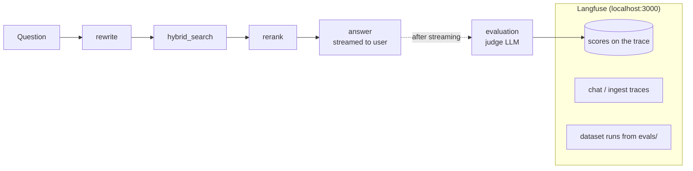

# Observability and answer evaluation

Every question and every upload is traced to a **self-hosted Langfuse**. After each answer finishes streaming, a **judge model** grades it in the background, and the scores are attached to the trace. An **offline suite** (`backend/evals/`) runs a golden question set through the real pipeline and scores it with our metrics plus **RAGAS**, so changes can be compared run against run.

Scores are for developers. The chat UI is unchanged.



## What is measured

| Score | Range | How it is computed | What it tells you |
| --- | --- | --- | --- |
| `groundedness` | 0–1 | The judge splits the answer into atomic claims and checks each against the `<source>` excerpts the answer saw. Supported ÷ total claims. A pure "does not specify" answer scores 1. | Is the answer faithful to the retrieved text (no hallucination)? Unsupported claims are listed in the score comment. |
| `context_relevance` | 0–1 | The judge rates every retrieved source 0/1/2 for the question; mean ÷ 2. Sources it didn't rate count as 0. | Are the retrieved chunks about the question? Low = retrieval noise; irrelevant source numbers are in the comment. |
| `answer_relevance` | 0–1 | The judge rates whether the answer addresses the question (0/1/2 ÷ 2). | Did it answer what was asked? |
| `citation_validity` | 0–1 | Share of `[Source N]` tags that point to a source that exists. No citations at all scores 0 (1 for a refusal). | Fabricated or missing citations. |
| `citation_coverage` | 0–1 | Share of substantive sentences carrying at least one `[Source N]`. | How much of the answer is traceable. |
| `retrieval_strength` | 0–1 | 0.6 × best dense cosine similarity + 0.4 × share of the top 3 sources found by **both** the dense and the BM25 retriever. | No LLM needed: a weak value warns that the document may not contain the answer. |
| `not_in_document` | bool | The answer *opens* with "The policy document does not specify…" (a "does not specify" caveat inside a full answer doesn't count). | Refusals, tracked separately so they don't look like failures. |
| `confidence` | 0–1 | 0.5·groundedness + 0.25·context_relevance + 0.15·answer_relevance + 0.1·citation_validity | One number to sort and filter by. |
| `confidence_label` | High / Medium / Low | High ≥ 0.8, Medium ≥ 0.5, else Low. | Triage. |
| `eval_error` | bool | The judge call failed or returned invalid JSON (after one retry); the comment has the error. | Judge health. |

**Why "confidence" is a composite.** LLMs don't expose a calibrated probability that an answer is correct, and most providers (Anthropic included) expose no token log-probabilities. So confidence is built from signals that can actually be measured: groundedness weighs most, because an ungrounded answer is the main failure for this product.

The metrics follow the **RAG triad** popularised by TruLens (context relevance → groundedness → answer relevance). They are computed with **one judge call per answer**, so live scoring stays cheap.

### Offline suite metrics (in addition to the above)

| Metric | Source | Meaning |
| --- | --- | --- |
| `hit_at_k` | ours | One of the question's expected pages is among the retrieved sources. |
| `refusal_correct` | ours | "Not in document" questions are refused; answerable ones are not. |
| `faithfulness` | RAGAS | Claims in the answer inferable from the contexts (RAGAS's own claim extraction + NLI). |
| `answer_relevancy` | RAGAS | Similarity between the question and questions regenerated from the answer (uses embeddings). |
| `context_precision` | RAGAS | Are the relevant contexts ranked above the irrelevant ones (judged against the reference answer)? |
| `context_recall` | RAGAS | Does the retrieved context contain what the reference answer needs? |

Our `groundedness` and RAGAS `faithfulness` measure the same thing with different prompts. Large disagreements between them are worth a look.

## Turning it on and off

Two switches in `backend/.env` control it. Restart the backend after changing either.

| `OBSERVABILITY_ENABLED` | `EVAL_ENABLED` | Tracing in Langfuse | Free scores (citations, retrieval strength, not-in-document) | Judge scores (groundedness, relevance, confidence) | Extra LLM tokens |
| --- | --- | --- | --- | --- | --- |
| `false` | (ignored) | off | off | off | none |
| `true` | `false` | on | on | off | **none** |
| `true` | `true` | on | on | on | one judge call per answer (~5–8k tokens) |

- **Tracing costs no LLM tokens.** It records calls that happen anyway. Only the judge spends tokens.
- `EVAL_SAMPLE_RATE` (0–1) grades only that share of answers when the judge is on; e.g. `0.1` grades 1 in 10.
- Leaving the Langfuse keys empty also turns everything off.
- The offline suite (`evals/run_evals.py`) only spends tokens when you run it.

## Setting it up

### 1. Start Langfuse (once)

```bash
cd infra/langfuse
docker compose up -d
```

- `docker-compose.yml` is Langfuse's official file, unmodified. `docker-compose.override.yml` binds every port to `127.0.0.1`, because traces contain policy text and must not be reachable from the network.
- `infra/langfuse/.env` (gitignored) holds generated secrets and `LANGFUSE_INIT_*` values that create the organisation, the project **Policy Analyser** and its API keys on first start. To recreate it, copy the keys from that file, or delete the volumes (`docker compose down -v`) and generate a new `.env`.
- Open **http://localhost:3000** and sign in with `LANGFUSE_INIT_USER_EMAIL` / `LANGFUSE_INIT_USER_PASSWORD` from that file.

### 2. Point the backend at it

In `backend/.env` (already filled in on this machine):

```dotenv
LANGFUSE_PUBLIC_KEY=pk-lf-...
LANGFUSE_SECRET_KEY=sk-lf-...
LANGFUSE_HOST=http://localhost:3000
EVAL_ENABLED=true
EVAL_SAMPLE_RATE=1.0
JUDGE_PROVIDER=        # blank = chat provider, with its cheaper model
JUDGE_MODEL=
```

Restart the backend. The log shows `Langfuse tracing enabled`, and each answer logs one line of scores (numbers only; document text is never written to the application log).

With the keys empty, tracing and live scoring are switched off and `app/observability.py` turns every call into a no-op. Tests always run that way.

### 3. Run the offline suite

```bash
cd backend
.venv/Scripts/python -m pip install -r requirements-eval.txt
.venv/Scripts/python -m evals.run_evals --name my-change
```

Options:

- `--limit N`: run only the first N questions.
- `--no-ragas`: skip the RAGAS metrics (fewer LLM calls).
- `--no-langfuse`: don't upload the run.
- `--dataset`, `--pdf`: use another question set or document.

Reports go to `backend/evals/reports/<name>.md` and `.csv`. That folder is gitignored, because reports on real policies contain their text. With Langfuse on, the run is uploaded as a **dataset run** on the `sample_policy` dataset. In Langfuse, open *Datasets → sample_policy → Runs* to compare runs side by side.

The golden set (`evals/datasets/sample_policy.jsonl`, 26 questions) covers table lookups, waiting periods, exclusions, definitions, the premium chart, the scanned claims page and two questions the policy doesn't answer. Add a JSONL file per real policy you want to track.

## Reading Langfuse

- **Tracing → filter `name = chat`.** Each trace holds `rewrite` → `hybrid_search` (each candidate with its dense rank and similarity, BM25 rank and matched text) → `rerank` → `answer` (model, tokens, latency, cost) → `evaluation` → `judge`.
- **Scores tab, or the score columns in the traces table.** Sort by `confidence` or filter `confidence_label = Low` to find bad answers. A Low with high `context_relevance` points to a generation problem; a Low with low `context_relevance` points to a retrieval problem.
- **Sessions.** Traces from the same uploaded document share a session (a hash of the session id).
- **`ingest` traces** show per-stage timings and counts, plus the vision and table-summary LLM calls.

## Cost and latency

- Live scoring is one call to the judge model per answer, e.g. `gpt-4.1-mini` when chatting with `gpt-4.1`. It starts after the answer has streamed, so users never wait for it (it typically finishes 2–6 s later).
- Use `EVAL_SAMPLE_RATE` to score only a share of answers.
- A RAGAS run makes several judge calls per question. 26 questions cost cents with a mini-class judge model.

## Implementation map

| File | Role |
| --- | --- |
| `backend/app/observability.py` | The only module that imports Langfuse: client setup, `Span` wrapper (no-op when disabled), LangChain callback handler, scores, flush. |
| `backend/app/evaluation.py` | Judge prompt, JSON parsing, metric formulas, heuristics, `record_scores`. |
| `backend/app/rag.py` | `chat` trace, child spans, background evaluation task after streaming. |
| `backend/app/store.py` | `Hit.dense_rank`, `dense_sim`, `bm25_rank` (retrieval diagnostics). |
| `backend/app/ingestion/pipeline.py` | `ingest` trace with a span per stage. |
| `backend/evals/run_evals.py` | Offline suite, reports, Langfuse dataset runs. |
| `backend/evals/ragas_compat.py` | Shim so RAGAS 0.4.3 imports alongside LangChain 1.x (see the docstring). |
| `infra/langfuse/` | Self-hosted Langfuse (official compose + localhost-only override + generated secrets). |
