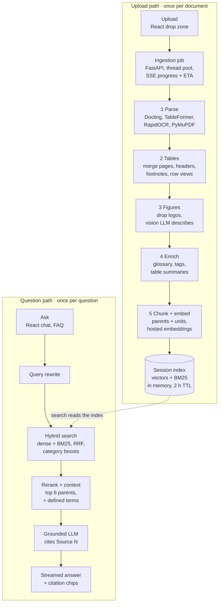

# Insurance Policy Analyser — Project Overview

*Last updated 2026-10-24. For implementation detail see [TECHNICAL_DESIGN.md](TECHNICAL_DESIGN.md); for a file-by-file map see [ARCHITECTURE.md](ARCHITECTURE.md).*

## Goal

The Insurance Policy Analyser lets someone who is considering a health insurance policy upload its document and ask plain-language questions about it. Every answer is grounded only in that document and cites the page, table or figure it came from.

The core flow is a retrieval-augmented generation (RAG) chatbot that builds its index on the fly, when the document is uploaded:

1. The user uploads a policy wording, brochure or benefit schedule (PDF or DOCX).
2. The app parses it, normalises its tables and figures, and embeds it into an in-memory index for that session.
3. The user asks questions such as "What is the waiting period for pre-existing diseases?" or "Is there a room-rent cap on the Silver plan?", or picks one from the built-in list of common questions.
4. The app retrieves the relevant clauses and table rows, and the LLM answers with conditions, exclusions and citations.

The app explains what the document says. It does not recommend whether to buy a policy. Further features (multi-policy comparison, summary cards, persistence) are planned on top of this core.

## Why insurance documents are hard

The ingestion engine is the heart of the project. Naive text extraction flattens a benefit table into word salad, and then the LLM cannot tell which limit belongs to which plan.

| Challenge | Example in a policy | What goes wrong with plain text |
| --- | --- | --- |
| Benefit tables with merged, multi-row headers | "Plan Variant" spanning Silver and Gold columns | Values lose their plan and row |
| Tables that run across pages | A 40-row schedule of benefits over 2 pages | The second half loses its header |
| Group rows | "In-patient Benefits" spanning the whole row | Rows lose their category |
| Footnote markers in cells | "1% of Sum Insured\*", "Rs. 75,000#" | The real condition (a waiting period, a deduction) is cut off from the value |
| Text that overflows a cell border | "Rs. 75,000 (caesarean)#" | The table model clips the overflow |
| Charts and infographics | Premium by age band, claim-process flow | The numbers exist only as pixels |
| A definitions section | "Pre-existing Disease means…" | Terms carry a precise legal meaning that the answer needs |
| Scanned pages | Image-only pages with no text layer | Nothing to extract without OCR |

## Architecture

Uploading runs the five ingestion stages once and leaves a per-session hybrid index in memory. Each question is rewritten, searched against that index, reranked and answered by the LLM, with tokens and citations streamed back to the chat.

## Ingestion pipeline

Ingestion runs as a background job in five stages. It streams live progress to the UI: page by page while parsing, then stage by stage, with an estimated time remaining. A 4-page sample policy is processed in about 19 s on CPU once the models are loaded. Every parser produces the same parser-neutral model (`ParsedDocument` → headings, text, list items, footnotes, `TableGrid`, `Figure`), so later stages never depend on Docling.

1. **Parse**: `app/ingestion/docling_parser.py`
   - PyMuPDF triage marks pages with no text layer, which are reported as OCR pages.
   - Docling's layout model finds headings, paragraphs, lists, tables, figures and captions in reading order, and drops page headers and footers. The PDF is processed in 2-page batches, so progress is real rather than simulated.
   - TableFormer (accurate mode, with cell matching) recovers each table's grid, including spanning cells and which rows are headers.
   - RapidOCR runs only on bitmap regions and image-only pages.
   - Clipped-text recovery uses PyMuPDF word coordinates to put back words that overflow a cell border, which TableFormer would otherwise drop.
   - Heading levels come from the policy's own numbering ("4.2.1") rather than from the layout model.
2. **Tables**: `app/ingestion/tables.py`
   - Footnote-looking lines (`*`, `#`, `¹`) just after a table are absorbed into that table.
   - A table continues onto the next page only if both have the same column count and header, the first ends near the bottom of its page, and the next starts near the top. Such tables are merged, dropping the repeated header.
   - Multi-row headers are flattened (`Plan Variant › Gold`). Full-width rows become group labels on the rows below them (`In-patient Benefits › Room Rent`), and empty merged row labels are forward-filled.
   - Footnote markers in cells are linked to their footnote text.
   - Each table gets three views: a markdown grid (what the LLM reads), one self-contained sentence per row (what gets searched), and a summary. Tables over 40 rows are split into row groups, with the header repeated in each.
3. **Figures**: `app/ingestion/figures.py`
   - Logos and icons are dropped by size.
   - Each remaining figure is sent to the vision LLM, which describes it, transcribes its text, extracts its numbers as a table, and lists the steps of a flow.
   - If vision is off or fails, the caption plus the text found inside the figure is used instead.
4. **Enrichment**: `app/ingestion/enrich.py`
   - A definitions glossary is built from the Definitions section; it is injected at answer time.
   - Keyword category tags (coverage, exclusion, waiting period, sub-limit, co-pay, claims, renewal, premium), with an optional LLM fallback.
   - LLM table summaries run concurrently.
5. **Chunking and embedding**: `app/ingestion/chunking.py`, `app/store.py`
   - Two-level index: **parents** are what the LLM reads (section windows of up to about 3,200 characters, whole tables, figure descriptions). **Units** are what gets searched (prose chunks of about 900 characters, table-row sentences, table summaries, figure descriptions). Every unit points at its parent.
   - Every unit starts with a contextual header, e.g. `[policy.pdf › 3. Schedule of Benefits] (Table: …)`.
   - Units are embedded in concurrent batches into a NumPy matrix, and a BM25 index is built over the same units.

The result is an ingestion report shown in the UI: pages, tables (with previews so the user can check them), figures, OCR pages, defined terms, warnings and timings.

## Retrieval and answering

Each question runs through `app/rag.py` and comes back as a streamed answer plus a list of citations.

1. **Query rewrite**: when there is chat history, the LLM rewrites a follow-up ("and for Gold?") into a standalone search query.
2. **Hybrid search** (`HybridIndex.search`):
   - Top 20 by dense cosine similarity and top 20 by BM25 are fused with reciprocal-rank fusion (k = 60).
   - The BM25 tokenizer keeps insurance terms intact: `co-payment` also matches `copayment`, and `20%` and `₹` are kept.
   - Units whose category matches the question's intent get a ×1.2 boost. A coverage question also boosts exclusion, waiting-period and sub-limit chunks, so the caveats come back too.
   - Hits collapse to their parents. A parent's score is its best unit plus 0.15 × its next two hits, so a large table can't win on row count alone.
3. **Rerank** (optional): the Cohere reranker narrows the candidates to the final 6. When reranking is off, the fused order is kept.
4. **Context assembly**: parents become numbered `<source>` blocks with type, pages and section path, capped at about 24,000 characters. Glossary definitions for any defined term in the question or the excerpts are added.
5. **Grounded prompt** (`app/prompts.py`): answer only from the excerpts; cite `[Source N]`; for tables, name the plan (column) and benefit (row); always surface waiting periods, exclusions, sub-limits, co-pays and footnotes; say "The policy document does not specify this" when the answer isn't there; no purchase advice.
6. **Streaming**: Server-Sent Events emit `query`, then `token` events, then `citations` (page, type, snippet, the full table or text, and a figure image link), then `done`.

## Policy fit score

A person fills in a health profile and gets a 1–10 score for how well the uploaded policy fits them, with the reasoning and citations. `app/fit_score.py` handles it, and `POST /fit-score` streams it.

1. **Rubric**: up to nine dimensions (pre-existing conditions, waiting periods, sum insured, co-payment, sub-limits, exclusions, maternity, extras, age limits and renewal). Each is weighted from the profile, and optional ones apply only when relevant.
2. **Retrieval per dimension**: fixed queries plus profile-driven ones (for example "diabetes coverage waiting period") go through the same hybrid search and rerank. Sources share one numbering across dimensions.
3. **Rating per dimension**: one LLM call per dimension, run concurrently, returns JSON: a 1–10 rating or null ("not specified"), a deal-breaker flag, a verdict and cited evidence.
4. **Score in code**: the weighted mean of rated dimensions, capped at 4 by a deal-breaker. Silent dimensions lower the confidence instead of the score.
5. **Reasoning**: a streamed LLM explanation ("What works for you", "Gaps and risks", "Check with the insurer") that cannot change the number.

## Frontend

The UI is a single-page React 19 + TypeScript app built with Vite. Its dev server proxies `/api/*` to the backend on port 8000. The layout is a sidebar (upload and ingestion report) beside the chat, and it collapses to one column on narrow screens. It supports light and dark themes.

| Component | File | What the user gets |
| --- | --- | --- |
| UploadPanel | `src/components/UploadPanel.tsx` | Drag-and-drop or browse for PDF/DOCX; an animated progress bar with percentage, a live "about m:ss left" countdown, elapsed time, and a stage checklist with a spinner and per-stage detail ("Reading page 8 of 40"), fed by the job's SSE stream |
| IngestionReport | `src/components/IngestionReport.tsx` | Counts (pages, tables, figures, definitions, OCR pages, search units), warnings, expandable table previews with merge and footnote info, figure crops, defined terms |
| FaqPanel | `src/components/FaqPanel.tsx`, `src/faq.ts` | 41 common health-insurance questions in 6 categories (Coverage, Waiting periods, Limits & costs, Exclusions, Claims, Renewal & premium) with tabs and search; click to ask |
| ChatWindow | `src/components/ChatWindow.tsx` | FAQ panel on the empty screens and a "Common questions" toggle mid-chat, streamed answers rendered as markdown (react-markdown + remark-gfm), citation chips per answer |
| SourceViewer | inside `ChatWindow.tsx` | Clicking a chip opens the cited table rendered as a grid, the text, or the figure image; Escape closes it |
| API client | `src/api.ts` | Upload, job watching, report fetch, and a fetch-based SSE parser for `POST /chat` (EventSource cannot POST) |
| FitScorePanel / Form / Result | `src/components/FitScore*.tsx` | The Policy fit score tab: a four-section health profile form (rupee amounts with a lakh/crore hint, client-side validation), then a score dial with band and confidence, streamed reasoning, and per-dimension cards with evidence and citation chips |
| App shell | `src/App.tsx` | Session state, the Chat / Policy fit score switch, chat history sent with each question, streaming updates to the last message |

## Tools and components by stage

| Stage | Tool / library | Version used | Role |
| --- | --- | --- | --- |
| Upload & API | FastAPI | 0.136 | REST endpoints, multipart upload, dependency-injected app state |
| Upload & API | Uvicorn | 0.54 | ASGI server |
| Upload & API | sse-starlette | 3.5 | Server-Sent Events for job progress and streamed answers |
| Upload & API | ThreadPoolExecutor (stdlib) | — | Background ingestion jobs (Docling is CPU-bound) |
| Parse | Docling (layout model + TableFormer) | 2.116 | Layout, reading order, table structure, figure crops, DOCX support |
| Parse | RapidOCR (via Docling, ONNX Runtime) | — | OCR for scanned / image-only pages |
| Parse | PyMuPDF | 1.28 | Text-layer triage, word coordinates for clipped-cell recovery |
| Tables, enrichment, chunking | Custom Python modules | — | Cross-page merge, header flattening, footnote linking, glossary, tagging, parent/unit chunking |
| Chunking | LangChain text splitters | 1.1 | Recursive splitting of long paragraphs |
| Figures & summaries | Vision / chat LLM via LangChain `init_chat_model` | 1.x | Chart descriptions, table summaries, query rewrite, answers |
| Embeddings | OpenAI / Voyage / Cohere embeddings via LangChain | — | Hosted embeddings of search units |
| Index | NumPy | — | Normalised embedding matrix, cosine search |
| Index | rank-bm25 | 0.2.2 | Lexical BM25 search |
| Rerank | Cohere Rerank (optional) | — | Final re-ordering of candidates |
| Config | pydantic-settings + python-dotenv | 2.14 | `.env`-driven settings; keys exported for provider SDKs |
| Frontend | React + TypeScript + Vite | 19 / 6 / 8 | Chat UI, dev proxy |
| Frontend | react-markdown + remark-gfm | 10 / 4 | Rendering answers and table grids |
| Tests | pytest, FastAPI TestClient, ReportLab, Pillow | — | Unit, end-to-end and API tests; synthetic fixture PDF |

## Configuration and providers

Every model is pluggable through `backend/.env`, so switching provider is a config change, not a code change (`app/config.py`, `app/providers.py`). The file is laid out in three steps: choose the chat LLM, paste the API keys, choose the embedding provider.

| Setting | Options | Default |
| --- | --- | --- |
| `LLM_PROVIDER` / `LLM_MODEL` | Any `init_chat_model` provider: anthropic, openai, google_genai, groq, mistralai, ollama; or `fake` | anthropic / claude-sonnet-5-5 |
| `VISION_PROVIDER` / `VISION_MODEL` | Same as above, must accept images; blank = reuse the chat LLM | blank |
| `EMBED_PROVIDER` / `EMBED_MODEL` | openai, voyage, cohere, `fake` | openai / text-embedding-3-small |
| `RERANK_PROVIDER` | none, cohere | none |
| `ENABLE_OCR`, `ENABLE_VISION`, `ENABLE_TABLE_SUMMARIES`, `ENABLE_LLM_TAGGING` | true / false | true, true, true, false |
| `MAX_UPLOAD_MB`, `MAX_PAGES`, `SESSION_TTL_MINUTES` | numbers | 25, 400, 120 |

Anthropic has no embeddings API, so a Claude setup needs a second provider for embeddings.

**Offline mode** (`fake` for both the LLM and embeddings) runs the whole app without API keys:

- The fake LLM echoes the best-matching excerpt instead of writing an answer.
- Embeddings are deterministic but random, so only the BM25 leg of search is meaningful.
- Vision and LLM summaries are skipped.

This mode is used by the tests and for checking ingestion and the UI.

## Testing and verification

All 26 backend tests pass: 20 fast unit tests and 6 slow tests that run the real Docling models, in about 50–60 s. The UI was also driven end to end in a browser. Every run so far used offline (`fake`) models. The real LLM, vision and embedding providers have not been exercised yet.

A generated fixture, `tests/fixtures/make_sample_policy.py`, is a fictional 4-page policy built to cover the hard cases: a 2-page benefit table with a 2-row header, spanning cells and group rows, `*` and `#` footnotes, an overflowing cell, a premium chart, and a rasterised (scanned) claims page.

| Test file | What it checks |
| --- | --- |
| `test_tables.py` | Cross-page merge rules, footnote absorption, header flattening, group rows, forward-fill, footnote linking, header inference, row groups |
| `test_enrich_and_store.py` | Definition extraction, longest-term matching, category tags, BM25 tokenizer, parent/unit structure, hybrid search, session isolation and TTL |
| `test_ingestion_e2e.py` | On the fixture: table merged from 2 pages into 36 rows × 3 columns with 2 footnotes; cell values under the right plan; 4 definitions; OCR text from page 4; the chart described; golden retrieval hit rate ≥ 75%; answer stream shape |
| `test_api.py` | Health, upload validation, unknown-session 404, then upload → job → report → figure PNG → chat SSE → delete |

Issues found and fixed during verification:

- **Clipped cell text**: TableFormer dropped "(caesarean)#" from an overflowing cell, which also lost its footnote. Fixed with PyMuPDF word-coordinate recovery.
- **Ranking bias**: big tables won on hit count alone. The parent score now counts only the next two hits, at 0.15 weight.
- **Definition parsing**: missed numbering such as "2.1 ". The regex was fixed.
- **React crash**: newer browsers return a Promise from `scrollIntoView`, which broke an effect's cleanup. Fixed.
- **Env keys**: keys in `.env` were never exported to the provider SDKs. Fixed with `load_dotenv`.
- **Wrong uvicorn**: running `uvicorn` used the global Python. Fixed by installing uvicorn into the venv.
- **Progress looked stuck**: parsing was one long blocking call. Fixed by parsing in 2-page batches with a live ETA.

## Privacy, limitations and roadmap

**Privacy.** Policy documents can contain personal data such as names and policy or member numbers.

- Documents are processed in memory only and never written to disk, and their contents are never logged.
- A session is evicted after 120 idle minutes, and `DELETE /documents/{id}` removes it immediately.
- Text and figure images are sent to the configured embedding and LLM/vision providers. Use a local Ollama model if that is not acceptable.
- The fit-score health profile lives only for one request. It is never stored or logged, and traces get a redacted summary. It is sent to the LLM provider inside the prompts.

**Current limitations**

- Sessions live in one process's memory, so a restart clears every upload and there's no horizontal scaling.
- Only Docling is implemented. The `pymupdf4llm`, LlamaParse and Azure Document Intelligence parsers are stubs.
- Cross-page table merging is heuristic: it needs the same column count and a matching header, or no header.
- No authentication, and no evaluation against real-model answers yet.

**Roadmap**

- [ ] Run the sample and real policies with real providers and tune the prompts
- [ ] Persistent vector store (pgvector or Chroma)
- [ ] Multi-policy comparison built on the normalised tables
- [ ] Auto-generated policy summary card
- [ ] Hosted parser backends for the hardest scans
- [ ] Authentication
- [ ] RAGAS evaluation suite
