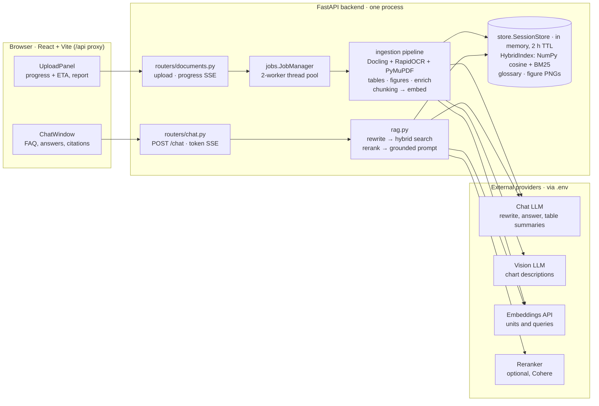
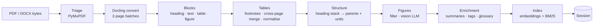
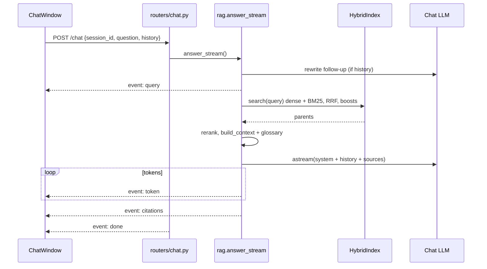

# Insurance Policy Analyser — Technical Design

*Status: implemented (MVP). Last updated 2026-10-24.*

## 1. Problem statement

A prospective buyer of a health insurance policy needs answers to specific questions, and those answers are buried in a 30–150 page policy wording: "What is the waiting period for pre-existing diseases?", "Is there a room-rent cap on the Silver plan?", "Is maternity covered, and with what sub-limit?". The answer must come **only from that document**, with a citation the user can check. General knowledge about insurance, or another insurer's terms, is wrong by definition.

This is a retrieval-augmented generation (RAG) problem with two hard constraints: the corpus is a single user-uploaded document indexed **at upload time**, and the content is structurally hostile to standard RAG pipelines.

### Why a naive RAG pipeline fails here

A standard pipeline is: extract text with PyPDF, split into fixed-size chunks, embed, retrieve top-k, answer. It breaks on insurance documents in specific, repeatable ways:

| Failure mode | Cause | Effect on answers |
| --- | --- | --- |
| Table flattening | Text extraction serialises a benefit grid row by row with no column structure | "1% of Sum Insured" cannot be attributed to Silver or Gold |
| Header loss across pages | Benefit schedules span 2–5 pages; continuation pages repeat or omit the header | Rows on page 2 lose their column meaning |
| Merged / multi-row headers | "Plan Variant" spans "Silver" and "Gold" | Column names become ambiguous or wrong |
| Group rows | "In-patient Benefits" spans a whole row as a section label | Rows lose their category |
| Footnote decoupling | Conditions live in `*`/`#` footnotes below the table | Answers omit the waiting period or deduction that changes the answer |
| Fixed-size chunking | Splits cut through tables and clauses | Retrieved chunks carry half a table or half a condition |
| Charts | Premium charts and claim flow diagrams are images | Numbers are invisible to text search |
| Defined terms | "Pre-existing Disease", "Hospital" have precise legal definitions | The LLM substitutes the everyday meaning |
| Scanned pages | No text layer | Content silently missing |
| Lexical precision | Users ask with exact terms ("AYUSH", "co-payment", "Section 4.2") | Pure dense retrieval under-ranks exact matches |

The core engineering problem is therefore **document understanding at ingestion time**. It means recovering table structure, the hierarchy, footnotes, figures and definitions, then indexing them so the retrieval unit is precise while the context given to the LLM stays complete.

## 2. Goals, non-goals and constraints

**Goals**

1. Answer free-form questions about one uploaded policy (PDF or DOCX), grounded only in that document, with page-, table- or figure-level citations.
2. Preserve table semantics end to end: every value is attributable to its plan (column), benefit (row), group and footnote conditions.
3. Index on the fly, so a document is queryable within seconds to minutes of upload with no pre-built corpus.
4. Surface caveats proactively: waiting periods, exclusions, sub-limits, co-pays and footnotes that change an answer.
5. Keep the LLM, vision and embedding providers pluggable through configuration.
6. Show the user what was extracted (an ingestion report) and live progress with an ETA during ingestion.

**Non-goals for this version:** recommending whether to buy, comparing multiple policies, persistence across restarts, authentication, multi-tenant scaling.

**Requirements and constraints**

| Area | Requirement | How it is met |
| --- | --- | --- |
| Grounding | No outside knowledge; explicit "does not specify" when absent | System prompt rules + numbered sources + citation events |
| Latency | Ingestion of a typical policy in the order of a minute on CPU; first answer token in a few seconds | Batched parsing, concurrent LLM/embedding calls, streamed answers |
| Hardware | Must run on a developer laptop CPU, no GPU required | Docling on CPU; hosted embeddings and LLM |
| Privacy | Policy documents contain PII (names, policy and member numbers) | In-memory sessions with TTL, no document text in logs, nothing written to disk |
| Portability | Provider choice is the user's (Anthropic, OpenAI, Gemini, Groq, Mistral, Ollama) | LangChain `init_chat_model` + embedding factory driven by `.env` |
| Testability | Full pipeline testable without API keys | `fake` LLM and embedding providers |
| Limits | Upload ≤ 25 MB, ≤ 400 pages (configurable) | Validated in the upload route and in parser triage |

## 3. System architecture



Everything runs in one Uvicorn process. The upload path runs the ingestion pipeline in a background thread and leaves a `Session` in the in-memory `SessionStore`. The chat path reads that index. Both paths call external model providers selected in `backend/.env`:

- The pipeline calls the vision LLM, the chat LLM for table summaries, and the embeddings API.
- `rag.py` calls the chat LLM for rewrite and answer, the embeddings API for the query, and optionally the reranker.

Docling and OCR run locally on CPU.

## 4. Key design decisions

| # | Decision | Options considered | Chosen | Rationale |
| --- | --- | --- | --- | --- |
| D1 | Document parser | PyPDF / PyMuPDF text; pymupdf4llm; Unstructured; LlamaParse (hosted); Azure Document Intelligence (hosted); **Docling** | Docling, behind a `Parser` interface | Local and CPU-capable (no document leaves the machine for parsing), MIT licence, layout model + TableFormer recover spanning cells and header rows, built-in OCR, DOCX support. Hosted parsers are kept as future backends behind the same interface. |
| D2 | Parser output | Use `DoclingDocument` everywhere; **own parser-neutral model** | `ParsedDocument` / `Block` / `TableGrid` / `Figure` | Isolates Docling to one module, keeps table logic unit-testable without models, and lets other parsers be added without touching downstream code. |
| D3 | Table representation | Markdown only; HTML only; row-per-chunk only; **three views** | Markdown grid + row sentences + summary | The grid is what the LLM reads (exact structure). Row sentences (`Benefit: Room Rent \| Plan Variant › Silver: 1% …`) give precise retrieval. Summaries match broad questions ("what does the schedule cover?"). |
| D4 | Chunking | Fixed-size; recursive; Docling HybridChunker; **custom structure-aware, two-level** | Custom parents and units | Tables and figures must never mix with prose, and the retrieval unit (a row, a 900-character chunk) is smaller than the LLM context unit (a whole table or section window). A custom builder over our own model gives that control. |
| D5 | Retrieval | Dense only; BM25 only; LangChain EnsembleRetriever; **custom hybrid with RRF** | NumPy cosine + rank-bm25, fused with reciprocal-rank fusion | Insurance queries mix semantics with exact tokens ("AYUSH", "co-payment", "30 days"). A custom fusion allows category boosts, parent collapse with a volume cap, and avoids `langchain-classic`. |
| D6 | Vector store | Chroma; FAISS; LangChain InMemoryVectorStore; **NumPy matrix** | NumPy, per session | One document has hundreds to a few thousand units, so brute-force cosine is sub-millisecond. No persistence is needed by design (privacy). Concurrent embedding batches are easy to control. |
| D7 | Embedding model | Local sentence-transformers; **hosted API** | Hosted (OpenAI default; Voyage, Cohere) | A product decision: better quality without local GPU or memory cost. A `fake` provider covers offline development. |
| D8 | LLM integration | Direct SDKs; **LangChain `init_chat_model`** | LangChain 1.x | One interface for chat, vision (standard image content blocks), streaming and batching across providers; switching is configuration only. |
| D9 | Charts and figures | Ignore; OCR text only; **vision LLM + fallback** | Vision LLM describes and extracts numbers; caption + OCR fallback | Premium charts and flow diagrams carry answerable facts. Size-based filtering skips logos, to control cost. |
| D10 | Definitions | Rely on retrieval; **glossary injection** | Regex glossary from the Definitions section, injected per query | Defined terms override everyday meaning; injecting the policy's own definition is cheap and deterministic. |
| D11 | Streaming transport | WebSockets; polling; **Server-Sent Events** | SSE for job progress and answer tokens | One-way server → client streams over plain HTTP. The chat uses fetch + manual SSE parsing because EventSource cannot POST. |
| D12 | Ingestion execution | Synchronous request; Celery/RQ; **in-process thread pool** | `ThreadPoolExecutor` (2 workers) + job registry | Docling is CPU-bound and blocking. A queue system is unnecessary for a single-process MVP; the job abstraction keeps the swap easy later. |
| D13 | Progress reporting | Fake animation; **real page-batch progress + learned ETA** | Docling `page_range` batches of 2 pages | Parsing dominates runtime and was opaque. Batching gives true per-page progress with negligible overhead; the ETA blends the live rate with the rate learned from previous uploads. |
| D14 | Clipped table cells | Accept the loss; **recover from the PDF text layer** | PyMuPDF word coordinates mapped back into cells | TableFormer's cell matching drops text that overflows a cell border. Found in testing, where "(caesarean)#" and its footnote link were lost. |

## 5. Ingestion engine design

Ingestion is orchestrated by `ingest()` in `app/ingestion/pipeline.py` and runs five stages over a parser-neutral model.



### 5.1 Parsing (`docling_parser.py`)

1. **Triage (PyMuPDF).** Count the pages and enforce `MAX_PAGES`. A page whose text layer has fewer than 40 characters is marked image-only and reported as an OCR page. Word boxes `(x0, y0, x1, y1, text)` are kept for every text-layer page.
2. **Docling conversion.** The `PdfPipelineOptions` are `do_ocr` (auto mode: RapidOCR on bitmap regions only), `do_table_structure` with `TableFormerMode.ACCURATE` and `do_cell_matching=True`, `generate_picture_images` at `images_scale=2.0`. The converter is built once, warmed at startup with `initialize_pipeline`, and guarded by a lock because it is not thread-safe.
3. **Page batching.** The PDF is converted with `page_range=(start, end)` in batches of 2 pages. Page numbers stay absolute. Blocks from each batch are concatenated and renumbered.
4. **Block mapping.** `iterate_items()` yields only body content (furniture such as page headers and footers is excluded).
   - `SectionHeaderItem` and `TITLE` become `heading`. The level comes from the numbering prefix (`4.2.1` → level 3), falling back to Docling's level.
   - `TableItem` becomes `table`, built from `data.grid` (spans expanded into every covered cell). The header-row count is the number of leading rows whose non-empty cells are all `column_header`. Caption, footnotes, page range and the vertical position ratios on the first and last page are kept.
   - `PictureItem` becomes `figure`, with a PNG crop, caption, the text found inside it, and its size in points.
   - Text and list items become `text` / `list_item` / `footnote`. Captions and footnotes already attached to a table or figure are skipped.
5. **Clipped-text recovery.** For each single-page table, any text-layer word whose centre is inside the table's vertical extent but outside every cell box (±1.5 pt) is assigned to its row band. It is then appended to the right-most cell in that row whose left edge is left of the word.

### 5.2 Table normalisation (`tables.py`)

1. `absorb_trailing_footnotes`: text or footnote blocks matching `^(\*{1,3}|#{1,2}|†|‡|§|[¹-⁹]|\^?\d{1,2}[.)]?|\(\d{1,2}\))\s*\S` directly after a table, under 600 characters, are attached to that table.
2. `merge_cross_page_tables`: table B continues table A only when all of these hold:
   - B is on A's last page + 1.
   - Both have the same column count.
   - B has no header, or the same header as A.
   - A ends at ≥ 70% of its page height and B starts at ≤ 35% of its page height.
   - Only footnotes appear between them.

   When merged, B's repeated header is dropped and the footnotes and page range are combined.
3. `normalise_table`:
   - Infer a header row when the parser found none (all cells filled, distinct and non-numeric).
   - Flatten multi-row headers per column, de-duplicating span repeats (`Plan Variant › Silver`), and make duplicate column names unique.
   - Treat full-width rows as group labels and prefix them onto the rows below (`In-patient Benefits › Room Rent`).
   - Forward-fill empty row labels.
   - Map footnote markers at the end of cells to their footnote text, giving per-row notes.
4. **Representations:**
   - `to_markdown(start, end)`: the grid plus `Note:` lines.
   - `row_sentence(i)`: `"{title} — col: value | … | Note: …"`.
   - `fallback_summary()`.

   Tables over 40 rows are split into row groups with the header repeated. Tables with fewer than 2 columns or 2 filled rows are treated as text, because the layout model sometimes boxes a single text column as a table.

### 5.3 Figures (`figures.py`)

- Figures smaller than 60 pt on a side or 12,000 pt² in area are dropped as decorative.
- The remaining figures go to the vision LLM in a batch through `llm.batch(..., max_concurrency=4)`. Each message holds a text block plus a standard `{"type": "image", "base64": …, "mime_type": "image/png"}` block.
- The prompt asks for a description, a full text transcription, numbers as a markdown table, and the steps of any flow.
- Fallback: caption + inner text, with the caption de-duplicated. `described_by_vision` drives the report status.

### 5.4 Enrichment (`enrich.py`)

- **Glossary.** Inside sections whose heading matches `definitions?|interpretation|glossary`, or in quoted terms anywhere, `DEFINITION_RE` captures `term (means|shall mean|refers to|is defined as|includes) definition` with optional numbering (`2.14`, `(a)`). It is stored as `term.lower() → Definition(term, text, page, section)`.
- **Category tags.** Regex families for `coverage`, `exclusion`, `waiting_period`, `sub_limit`, `co_pay`, `claims`, `renewal`, `premium` and `definitions`. A heading match scores 2 and a body match scores 1. Every category scoring ≥ max(2, top/2) is kept, otherwise the item is tagged `general`. An optional batched LLM classifier re-tags `general` parents (`ENABLE_LLM_TAGGING`).
- **Table summaries.** A 2–4 sentence summary per table from the first 60 rows, run concurrently, with the deterministic fallback.

### 5.5 Chunking and indexing (`chunking.py`, `store.py`)

The index has two levels:

| Level | Contents | Size | Used for |
| --- | --- | --- | --- |
| Parent | Section window of paragraphs; whole table (or 40-row group) as markdown; figure description | ≤ ~3,200 characters for text | What the LLM reads |
| Unit | Prose piece; table row sentence; table summary; figure description piece | ~900 characters for text (paragraphs over 1.3× are split with 120-character overlap) | What is embedded and searched |

Building the index:

- A heading stack produces `section_path`.
- Each unit is prefixed with a contextual header `[file › section › …] (Table: title)`.
- Unit metadata: `unit_id`, `parent_id`, `type`, `pages`, `section_path`, `categories`.
- Units are embedded in concurrent batches (`EMBED_BATCH_SIZE=64`, 4 threads) into an L2-normalised `float32` matrix.
- `BM25Okapi` is built over the same units with an insurance-aware tokenizer. It is lower-case, keeps `₹` and `%`, drops stop words, and expands `co-payment` into `co-payment`, `co`, `payment` and `copayment`.

## 6. Retrieval and answer generation

`answer_stream()` in `app/rag.py` is an async generator that yields `(event, payload)` pairs.



1. **Query rewrite.** If history is present, the last 6 turns (each truncated to 1,200 characters) plus the follow-up go to the LLM with `REWRITE_PROMPT`, which returns a standalone query. If the call fails, the raw question is used.
2. **Hybrid search** (`HybridIndex.search`, run in a worker thread through `asyncio.to_thread`):
   - Dense: cosine over the normalised matrix, top `RETRIEVE_K = 20`.
   - Sparse: BM25 scores, top 20 with score > 0.
   - Fusion: reciprocal-rank fusion.
   - Category boost: ×1.2 for units whose `categories` intersect `query_categories(query)`. Coverage-type questions ("is X covered") add `exclusion`, `waiting_period` and `sub_limit`, so the caveats are retrieved alongside the benefit.
   - Parent collapse: a parent's score is its best unit plus a 0.15 weight on its next two hits (the volume cap stops a 40-row table winning on hit count alone).
3. **Rerank.** The top max(2 × `FINAL_K`, 10) parents go through the `Reranker` protocol. `NoopReranker` truncates to `FINAL_K = 6`; `CohereReranker` uses `CohereRerank.compress_documents`.
4. **Context assembly** (`build_context`):
   - Each parent becomes `<source id="N" type pages section>…</source>`, with a total cap of 24,000 characters.
   - `find_terms` scans the question and excerpts for glossary terms, longest first ("Pre-existing Disease" wins over "Disease"), up to 5, which are added in a `<definitions>` block.
   - The citations list is built at the same time.
5. **Generation.** The messages are `SystemMessage(SYSTEM_PROMPT)`, the history turns, then `HumanMessage(ANSWER_TEMPLATE)`. The answer is streamed with `llm.astream`; each chunk's `.text` becomes a `token` event.

The RRF score used in step 2 is:

```math
\mathrm{score}(u) = \beta_{cat}(u) \sum_{r \in \{\text{dense},\, \text{bm25}\}} \frac{1}{60 + \mathrm{rank}_r(u) + 1}, \qquad \beta_{cat} \in \{1, 1.2\}
```

### Grounding prompt rules (`prompts.py`)

- Use only the excerpts; no outside knowledge of insurers, regulations or "typical" policies.
- When the answer is absent, reply exactly "The policy document does not specify this.", then mention the closest relevant text.
- Cite every fact as `[Source N]`, using only the source numbers given.
- For table values, name the plan (column) and the benefit (row). If no plan was named, give every plan.
- Always surface waiting periods, exclusions, sub-limits, co-payments, deductibles, age limits and footnotes.
- Use the policy's own definitions.
- Give a short direct answer first, then the conditions as bullets.
- No purchase or financial advice.

## 7. Data model and API contracts

### Core types

| Type | Module | Key fields |
| --- | --- | --- |
| `ParsedDocument` | `ingestion/models.py` | `filename`, `num_pages`, `blocks[]`, `ocr_pages[]`, `warnings[]`, `parser` |
| `Block` | `ingestion/models.py` | `kind` (heading, text, list_item, footnote, table, figure), `text`, `page`, `level`, `table`, `figure` |
| `TableGrid` | `ingestion/models.py` | `rows[][]` (spans expanded), `header_rows`, `caption`, `footnotes[]`, `page_start/end`, `top_ratio`, `bottom_ratio`, `merged_from` |
| `NormalisedTable` | `ingestion/tables.py` | `columns[]` (flattened), `rows[][]`, `row_notes[][]`, `title`, `section_path`, `summary`, `groups[]` |
| `Parent` | `ingestion/chunking.py` | `id`, `type` (text, table, figure), `text`, `pages[]`, `section_path[]`, `title`, `categories[]`, `ref` |
| Unit (`langchain_core.documents.Document`) | `ingestion/chunking.py` | `page_content` (header + text); metadata `unit_id`, `parent_id`, `type` (text, table_row, table_summary, figure), `pages`, `section_path`, `categories` |
| `Session` | `store.py` | `id`, `filename`, `index: HybridIndex`, `glossary`, `report`, `figures_png`, `last_access` |
| `Job` | `jobs.py` | `status`, `stage`, `message`, `percent`, `eta_seconds`, `session_id`, `error`, `version` |

### HTTP API (FastAPI, port 8000; proxied as `/api` by Vite)

| Method | Path | Request | Response |
| --- | --- | --- | --- |
| POST | `/documents` | multipart `file` (.pdf/.docx, ≤ 25 MB; PDF magic bytes checked) | `{job_id, filename}`; 415, 413 or 400 on bad input |
| GET | `/documents/jobs/{job_id}` | — | Job snapshot |
| GET | `/documents/jobs/{job_id}/events` | — | SSE `progress` events (snapshot JSON), closed on done or error |
| GET | `/documents/{sid}/report` | — | Ingestion report: pages, OCR pages, tables with previews, figures, definitions, unit counts, warnings, timings |
| GET | `/documents/{sid}/figures/{fid}.png` | — | PNG crop (in-memory only) |
| DELETE | `/documents/{sid}` | — | `{deleted: bool}` |
| POST | `/chat` | `{session_id, question (≤ 2,000 chars), history: [{role, content}]}` | SSE stream (below); 404 if the session has expired |
| GET | `/health`, `/` | — | Liveness and service info |

### Chat SSE event sequence

| Order | Event | Payload |
| --- | --- | --- |
| 1 | `query` | The standalone query actually used for retrieval |
| 2..n | `token` | Answer text fragment |
| n+1 | `citations` | `[{source, type, pages, page_label, section, title, snippet, content, figure_id}]` |
| on failure | `error` | Message (exception type + text, ≤ 400 characters) |
| last | `done` | `{}` |

The event names and payload shapes are a contract between `rag.py` / `routers/chat.py` and `frontend/src/api.ts`; change them together.

## 8. Concurrency, performance and progress

**Execution model**

- Uvicorn runs the FastAPI app on one event loop.
- Uploads return at once. `JobManager` runs `ingest()` on a 2-worker `ThreadPoolExecutor`.
- Docling conversion is serialised by a lock, so concurrent uploads queue at the parse stage and overlap in the other stages.
- Retrieval runs off the event loop via `asyncio.to_thread`. LLM and embedding I/O use LangChain batch (`max_concurrency = 4`) and a 4-thread embedding pool.
- A janitor task runs every 60 s. It evicts sessions idle longer than `SESSION_TTL_MINUTES` (120) and prunes finished jobs older than 1 h.
- Docling models are loaded in a background thread at startup (`warmup()` → `initialize_pipeline`).

**Measured on the 4-page sample (CPU, offline providers)**

| Phase | Time |
| --- | --- |
| Model warmup (models already in the local cache) | ~9 s |
| Parse pages 1–2 (text layer, benefit table) | ~7.8 s |
| Parse pages 3–4 (chart page + OCR page) | ~8.5 s |
| Tables, figures, enrichment, embedding (45 units, fake providers) | < 0.2 s |
| Full end-to-end ingestion after warmup | ~19 s |

With real providers, add vision calls (one per meaningful figure), table-summary calls (one per table, 4 concurrent) and hosted embedding round-trips.

**Progress and ETA**

Parsing is split into 2-page `page_range` batches, so its share of the bar (3% → 60%) advances per batch. The later stages start at 60%, 64%, 74% and 82%, and embedding advances per batch up to 99%. The ETA is recomputed at every progress event:

- While models load: `MODEL_LOAD_SEC (20) + rate × pages + after_parse(pages)`.
- During parsing: `rate = w · live_rate + (1 − w) · learned_rate`, where `w = min(1, pages_done / 4)`. ETA = `rate × pages_left + after_parse(pages)`.
- `after_parse(pages) = 2 + (0.15 + 0.6 if LLM enrichment is on) × pages`.
- After parsing: the ETA comes from the actual workload, `ceil(figures / 4) × 8 s + ceil(tables / 4) × 5 s + embedding batches`.
- The learned seconds-per-page is updated by an EMA (α = 0.5) after each upload.
- The frontend counts the ETA down every second between server updates, and shows the elapsed time, an animated bar and a spinner on the active stage (disabled under `prefers-reduced-motion`).

On the sample, the ETA at "page 1 of 4" was 14.6 s against an actual remainder of about 16 s.

## 9. Frameworks and libraries

Versions are those installed in the development environment (Python 3.12.3, Node 24.12).

| Layer | Library / framework | Version | Used for | Where |
| --- | --- | --- | --- | --- |
| API | FastAPI | 0.136 | Routing, multipart upload, dependency injection (`AppState`), lifespan | `main.py`, `routers/` |
| API | Uvicorn | 0.54 | ASGI server | runtime |
| API | sse-starlette | 3.5 | `EventSourceResponse` for job progress and chat tokens | `routers/` |
| API | python-multipart | — | Multipart parsing for uploads | `routers/documents.py` |
| Config | pydantic / pydantic-settings | 2.13 / 2.14 | Typed settings, request schemas | `config.py`, `schemas.py` |
| Config | python-dotenv | — | Export `.env` keys into `os.environ` for provider SDKs | `config.py` |
| Parsing | Docling (+ docling-core, docling-ibm-models, docling-parse) | 2.116 | Layout analysis, TableFormer table structure, picture crops, DOCX | `docling_parser.py` |
| Parsing | RapidOCR (ONNX Runtime) | via Docling | OCR of image-only regions and pages | `docling_parser.py` |
| Parsing | PyMuPDF | 1.28 | Text-layer triage, word coordinates for clipped-cell recovery | `docling_parser.py` |
| Parsing | PyTorch | 2.13 | Runtime for the Docling layout and TableFormer models (CPU) | indirect |
| LLM | LangChain (`langchain`, `langchain-core`) | 1.4 / 1.7 | `init_chat_model`, messages, `batch`/`astream`, `Document`, fake embeddings | `providers.py`, `rag.py`, `figures.py`, `enrich.py` |
| LLM | langchain-anthropic, langchain-openai | 1.7 / 1.7 | Claude and OpenAI chat; OpenAI embeddings | `providers.py` |
| LLM (optional) | langchain-google-genai, -groq, -mistralai, -ollama, -voyageai, -cohere | — | Other chat, embedding and rerank providers (lazy imports) | `providers.py` |
| Chunking | langchain-text-splitters | 1.1 | `RecursiveCharacterTextSplitter` for long paragraphs | `chunking.py` |
| Retrieval | NumPy | — | Normalised embedding matrix, cosine top-k | `store.py` |
| Retrieval | rank-bm25 | 0.2.2 | `BM25Okapi` lexical scoring | `store.py` |
| Frontend | React | 19.3 | UI components | `frontend/src` |
| Frontend | TypeScript | 6.0 | Types mirroring the API payloads | `frontend/src/api.ts` |
| Frontend | Vite | 8.3 | Dev server with `/api` proxy, production build | `vite.config.ts` |
| Frontend | react-markdown + remark-gfm | 10.1 / 4.0 | Rendering answers and GFM table grids | `ChatWindow.tsx`, `IngestionReport.tsx` |
| Tests | pytest | — | Unit, end-to-end and API tests, `slow` marker | `backend/tests` |
| Tests | httpx / FastAPI TestClient | — | In-process HTTP and SSE tests | `test_api.py` |
| Tests | ReportLab + Pillow | — | Generating the synthetic policy PDF and chart image | `fixtures/make_sample_policy.py` |

Providers and models currently configured by default: chat `claude-sonnet-5-5` (Anthropic) and embeddings `text-embedding-3-small` (OpenAI). Both are replaceable in `backend/.env`.

## 10. Testing strategy and verification

**Strategy.** Pure-logic modules (tables, enrichment, store) are unit-tested without models. The full pipeline is tested end to end with the **real Docling models** on a synthetic fixture, using `fake` LLM and embedding providers, so no API keys are needed and results are deterministic. The tests that load the models are marked `slow`.

**Fixture.** `tests/fixtures/make_sample_policy.py` (ReportLab + Pillow + PyMuPDF) generates a fictional 4-page policy containing:

- a 2-page benefit table with a 2-row spanning header (`Plan Variant` over Silver/Gold);
- a vertically merged `Benefit` header and two full-width group rows;
- `*` and `#` footnote markers, and a cell whose text overflows its border;
- a definitions section;
- a premium bar chart rendered as an image;
- a claims page rasterised at 200 dpi, so it has no text layer.

| Suite | Tests | Asserts |
| --- | --- | --- |
| `test_tables.py` | 9 | Merge rules (repeated header, headerless continuation, heading or shape breaks, mid-page end), footnote absorption, header flattening, group-row prefixes, forward-fill, footnote linking, header inference, row-group splitting |
| `test_enrich_and_store.py` | 8 | Definition regex variants, longest-term matching, category and query tags, tokenizer expansion, parent/unit structure and headers, BM25 leg and parent ranking, session isolation, TTL eviction, delete |
| `test_ingestion_e2e.py` (slow) | 5 | Table merged from 2 pages to 36 × 3 with 2 footnotes; `Silver: 1% of Sum Insured*` and `Gold: Single private room` under the right headers; group prefixes; `#` note on the maternity row; 4 defined terms; OCR text from page 4; chart text extracted; golden retrieval hit rate ≥ 75% over 8 questions; event order of the answer stream |
| `test_api.py` (1 slow) | 4 | Health; 415 and 400 upload validation; 404 for an unknown session; upload → job polling → report → figure PNG → chat SSE (`token`, `citations`, `done`) → delete → 404 |

**Result.** 26 of 26 pass (~50 s including model load). The frontend type-checks and builds (`tsc -b && vite build`). It was also driven in a browser: upload, progress, report, streamed answer, table and figure source viewers.

**Defects found by verification and fixed**

| Defect | Root cause | Fix |
| --- | --- | --- |
| "(caesarean)#" missing from a cell; footnote not linked | TableFormer cell matching clips overflow text | Clipped-word recovery from PyMuPDF word boxes |
| Large tables ranked first for every query | Parent score summed every unit hit | Cap at the next 2 hits × 0.15 |
| Definitions like "2.1 Hospital means" missed | Numbering regex required a trailing `.` or `)` | Optional punctuation, digit-led or short alphabetic numbering |
| UI crashed after the first render | `scrollIntoView` returns a Promise in newer browsers, so the effect returned a non-function | Effect body wrapped in a block |
| API keys in `.env` ignored | pydantic-settings does not export variables to `os.environ` | `load_dotenv(ENV_FILE)` in `get_settings()` |
| Progress stuck during parsing | One blocking `convert()` call with no callbacks | 2-page `page_range` batches + ETA |

**Not yet verified:** answer quality with real LLM, vision and embedding providers, and documents beyond the synthetic fixture.

## 11. Security, privacy, limitations and future work

**Security and privacy controls**

- Documents exist only in process memory: raw bytes during the job, then the session index and figure PNGs. Nothing is written to disk.
- Sessions are evicted after 120 idle minutes, and `DELETE /documents/{sid}` removes one immediately.
- Document text and chunk contents are never logged. Failures log the job id and exception type/message only.
- Uploads are validated by extension, size and PDF magic bytes. Questions are capped at 2,000 characters and history turns at 20,000.
- API keys live only in `backend/.env`, which is gitignored and loaded with real environment variables taking precedence.
- Document text and figure images **are sent to the configured embedding and LLM/vision providers**. Choosing `ollama` keeps chat and vision local.
- CORS is restricted to the Vite dev origins.

**Known limitations**

| Limitation | Impact | Mitigation path |
| --- | --- | --- |
| Single-process, in-memory sessions | A restart loses uploads; no horizontal scaling | Persistent vector store (pgvector or Chroma) + external job queue |
| Docling conversion serialised by a lock | Concurrent uploads queue at the parse stage | A pool of converters or worker processes |
| Cross-page merge is heuristic | A continuation with a different header, or one far down a page, stays split | Header-similarity scoring; LLM-assisted merge |
| Clipped-text recovery needs a text layer and a single-page table | OCR pages and multi-page Docling tables are not repaired | OCR-level word boxes |
| Glossary is regex-based | Unusual definition phrasing is missed | LLM extraction fallback |
| No authentication or rate limiting | Not deployable publicly as-is | Auth + per-user quotas |
| No evaluation against real models | Answer quality is unmeasured | RAGAS / golden Q&A suite on real policies |

**Future work**

- [ ] Run real policies end to end with production providers and tune the prompts and `FINAL_K`
- [ ] Golden Q&A and RAGAS evaluation (faithfulness, context precision)
- [ ] Multi-policy comparison using the normalised tables
- [ ] Auto-generated policy summary card (coverage, waiting periods, sub-limits, co-pay)
- [ ] Hosted parser backends (LlamaParse, Azure Document Intelligence) behind `Parser`
- [ ] Persistence, authentication and deployment packaging
